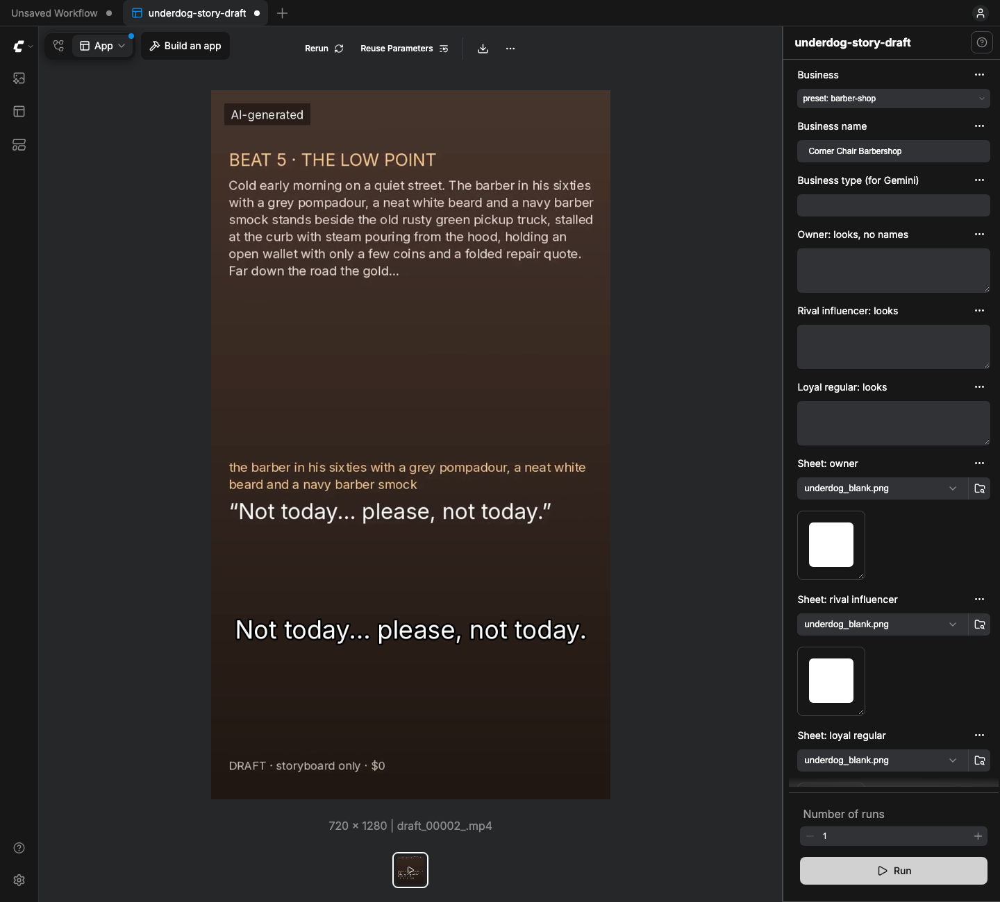
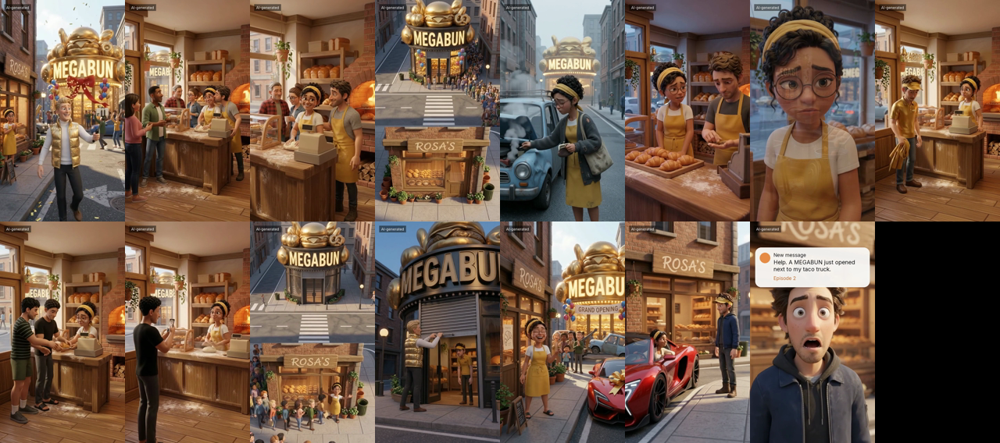

# Underdog Story

**Any small business → a 15-scene underdog sitcom, about 105 seconds, vertical, with voices, a score, captions and the
next-episode tease. Ready to post.**

A ComfyUI App Mode app. Pick a business (barber shop, taco truck, nail salon, bakery, or type any other and Gemini fills
in the details), add the character sheets, press **Run**. Every film follows the same arc, because it works:

1. A flashy rival chain has its grand opening across the street while its influencer vlogs it.
2. *Six months later* the regulars have drifted to the rival. One loyal regular stays.
3. The low point: the owner's old car dies on the way to work, there's no money for the fix, so they walk.
4. An ad-agency duo walks in. Bad ideas. Then the heart: the family heirloom behind the craft.
5. Their video goes viral (the view counter climbs) and the line comes back. The rival's landmark stays in frame.
6. Showdown: the owner sends the rival to the back of the line; the rival closes.
7. *Six months later*, the earned payoff: a new car while the old one is towed away. The out-of-work influencer asks
   "So... you hiring?" "Hmm. No."
8. A DM from another kind of business: "Help. A MEGA-something just opened next to my ...". Episode 2.

Built for the Comfy *Open Source Higgsfield* challenge, 2026. Apache-2.0.

<p align="center"></p>

## The sample: The Last Croissant (bakery)

The arc comes from *The Last Croissant*, a family-bakery episode. Its v9 rough cut was **drafted in Google Flow with the
same arc** (not made by this app): `docs/examples/the-last-croissant-v9-flow-draft.mp4` (89 s, 17 MB). The app's
bakery preset carries the same lines; the other presets fill the same beats for their own business.

<p align="center"></p>

## How it works

1. **Script.** `Underdog Story: Script` fills the 15-beat arc with one business's slots: what the rival calls the place,
   the signature product, an invented rival chain and its gimmick (no lookalikes of real brands), the loyal regular, the
   heirloom and the craft, the old car and the payoff. Built in: **barber shop**, **taco truck**, **nail salon**,
   **family bakery** (the v9 sample). For anything else, **Gemini** (partner node, only asked when picked) writes the
   slots. The script is checked before anything is drawn: one on-screen speaker per scene, every line 20 words or fewer
   and fits its take, characters described by looks (names only inside dialogue), no real brands, the rival landmark shot
   on a **LOCKED-OFF STATIC CAMERA**, a title card on every time jump, no answer without its question on screen, no crowd
   filing out through a door. A broken script stops the run before anything is paid for.
2. **Keyframes.** For each scene, **Nano Banana 2** draws the 9:16 start frame from the sheets that scene needs (owner,
   rival influencer, loyal regular, hero 1, hero 2, location, rival storefront). Props that matter later are in frame
   from the first shot.
3. **Animation.** For each scene, **Veo 3.1** turns the keyframe into a 6 or 8 s clip with dialogue and sound. Every
   motion prompt carries the rules: one continuous take, background life (extras walk, cars pass), no prop appears or
   vanishes, an ambience bed, dialogue ends a second before the take does (so a dissolve never cuts a word).
4. **Final cut** (the v9 recipe). Dissolves, the *SIX MONTHS LATER* / *NEXT MORNING* cards, the view counter
   (1,204 → 48K → 2.1M), the episode-2 DM built from the business's own slots, captions, an *AI-generated* label, an
   end card.
5. **Score and master.** **Sonilo** writes a score for the cut. The score is levelled first (`loudnorm I=-27 LRA=3
   TP=-6`), ducked under the dialogue with a sidechain compressor (`threshold 0.02, ratio 12, attack 40, release 450`),
   mixed, and the film is mastered to −14 LUFS / −1 dBTP.

The App Mode outputs: the film, a sheet of all 15 keyframes, and the script as text.

### The free draft ($0)

`workflows/underdog-story-draft.json` runs the same script and the same final cut with storyboard clips instead of
Nano Banana and Veo: each scene's shot description and lines over its location sheet, at the scene's real length.
No partner node is in that graph, so it never costs anything. Use it to check the story for a new business before
paying for a single frame.

## Install

Needs ComfyUI 0.42+ with frontend 1.41.13+ (App Mode) and `ffmpeg` on PATH. No model downloads, no GPU: all
generation runs on Comfy's partner API.

```bash
cd ComfyUI/custom_nodes
git clone <this repo> underdog-story
```

Restart ComfyUI and open `workflows/underdog-story.json` (or `underdog-story-draft.json` for the free draft). It opens in
App Mode.

### Comfy account and API key (partner nodes)

Gemini, Nano Banana 2, Veo and Sonilo are ComfyUI **partner nodes**: they run on Comfy's API and are paid with Comfy
credits. Sign in with **Sign in to run** (top right), or from a script send the key with the prompt:
`{"prompt": ..., "extra_data": {"api_key_comfy_org": "<your key>"}}`. Never commit the key.

## Cost

From the partner nodes' own price badges (ComfyUI 0.42), one film, built-in preset:

| Step | Price | Per film |
|---|---|---|
| Veo 3.1 **lite**, 720p, audio on | $0.05/s × 108 s of takes | **$5.40** |
| Nano Banana 2, 1K | $0.0835 × 15 keyframes | $1.25 |
| Sonilo video-to-music | $0.009/s × about 104 s | $0.94 |
| Gemini 3.1 Pro (only for a business without a preset) | $0.002–0.012 per 1K tokens | a few cents |
| **Total with lite** | | **about $7.60** |
| Free draft | | **$0** |

Veo `fast` is $0.10/s (about $10.80 of video), `full` $0.40/s (about $43). Seeds are fixed, so if one scene fails (for
example a safety filter), fix it and press Run again: ComfyUI re-uses every finished step and you only pay for what runs
again.

## Use it

1. **Business**: a preset, or *any other business: write with Gemini* plus the **business type** (`dog groomer`,
   `bike repair shop`…). Business name optional.
2. Optional: describe the **owner**, the **rival influencer** and the **loyal regular** by their looks (*the barber in
   his sixties with a grey pompadour*). No names: the models don't know who "Lou" is, and the app refuses real people's
   names. Empty = the preset's cast (or Gemini's). Hero 1 and hero 2 default to the house agency duo.
3. Add the **character sheets** (owner, rival influencer, loyal regular, hero 1, hero 2, location, rival storefront).
   Empty slots are skipped.
4. **Tone** (`funny` or `heartfelt`), **video model** (`veo-3.1-lite` default), **Sonilo score** on or off.
5. **Run.** The script shows first, then the keyframe sheet, then the finished film.

Only use sheets of fictional characters, or of real people who gave you permission. Keep the AI label on when you post.

## For developers

```bash
python3 tools/write_presets.py                 # regenerate the four presets from their slots
python3 tools/build_app.py [--draft]           # -> workflows/underdog-story[-draft]-api.json (API format)
python3 tools/check_graph.py workflows/underdog-story-api.json --url http://127.0.0.1:8193   # checks, never queues
node tools/make_app.mjs <url> workflows/underdog-story-api.json workflows/underdog-story.json docs/img/app-mode-form.png
node tools/e2e_draft.mjs <url> workflows/underdog-story-draft.json docs/img/app-mode.png    # real browser, runs the $0 draft
python3 -m pytest                              # partner nodes mocked; ffmpeg test clips; nothing is sent anywhere
python3 tools/run_paid_demo.py                 # dry run: sheets, graph check, estimate. $0, no key read
python3 tools/run_paid_demo.py --confirm-spend # the paid barber-shop demo (hard cap $10, ledger row before queueing)
```

`make_app.mjs` and `e2e_draft.mjs` need the `playwright` npm package. `e2e_draft.mjs` refuses any `POST /prompt` that
contains a partner node or an API key, so the end-to-end test cannot spend money.

## Licences and credits

Code, workflows and presets: Apache-2.0. Font: Inter (SIL OFL, `fonts/OFL.txt`). Generation: Google Gemini, Nano
Banana 2 and Veo 3.1, and Sonilo, through ComfyUI partner nodes (their terms apply to what you generate). The v9 sample
was drafted in Google Flow. Built by JK Automations.
